# Proyecto Ensamble: Ensamble de genoma a partir de datos de secuenciación de *Illumina* y *PacBio*

**Equipo 3**:

-   Héctor López Ordaz [hectorjl@lcg.unam.mx](mailto:hectorjl@lcg.unam.mx)

-   Ismael Maximiliano De Los Santos Huesca [ismadlsh@lcg.unam.mx](mailto:ismadlsh@lcg.unam.mx)

-   Mateo Jiménez Sotelo [majiso@lcg.unam.mx](mailto:majiso@lcg.unam.mx)

> [!NOTE]
> **Entorno y Reproducibilidad**: Este proyecto fue desarrollado y ejecutado en el clúster de cómputo del Centro de Ciencias Genómicas (LCG-UNAM). Las rutas absolutas documentadas corresponden al entorno institucional donde residían los datos y deben adaptarse al ejecutarse en otro sistema. Para consultar las dependencias de software, revise [`environment.yml`](environment.yml).

## Contenido

- [Resumen](#resumen)
- [Introducción](#introducción)
- [Metodología](#metodología)
  - [Datos y Control de Calidad (`fastqc`, `trim_galore`, `trimmomatic`)](#datos)
  - [Estrategias de Ensamblado (`velvet`, `unicycler`, `flye`, `canu`)](#ensamblado)
  - [Análisis y Comparativa de Ensambles (`quast`)](#análisis-de-ensambles)
  - [Mejoramiento del Ensamble (`pilon`, `mummer`)](#mejoramiento-del-ensamble)
  - [Anotación Funcional y Validación (`glimmer3`, `blastn`, `checkm`, `prokka`)](#anotación)
  - [Comparación de los Contigs contra sus Referencias](#comparación-de-los-contigs-contra-su-referencia)
- [Conclusiones](#conclusiones)
- [Referencias](#referencias)

---


# Resumen

En este proyecto buscamos integrar diferentes herramientas bioinformáticas en un *pipeline* para posibilitar el ensamblaje y caracterización del genoma de una bacteria desconocida, con base en datos de secuenciación de *Illumina* y *PacBio*. Gracias a esto, después de aplicar los filtros de calidad pertinentes a las secuencias y discernir sobre qué aproximación de ensamblado es la más óptima, determinamos que el genoma resultante, ensamblado con *Canu* y procesado por *Pilon*, pertenece a la bacteria *Cupriavidus gilardii*, putativamente a la cepa *WM02*.

# Introducción

*Cupriavidus gilardii* es una bacteria ambiental con alto potencial para la biorremediación. Pertenece a la familia *Burkholderiaceae*, y es comúnmente aislada de suelos contaminados con metales pesados, donde ha demostrado una resistencia excepcional y capacidad para detoxificar su entorno. Su versatilidad metabólica la hace una opción prometedora para aplicaciones biotecnológicas y de limpieza ambiental (Wikipedia contributors, 2025).

En este proyecto reconstruimos el genoma de un organismo mediante sus lecturas de *Illumina* y *PacBio* y, gracias a las distintas herramientas bioinformáticas vistas en el curso, pudimos identificar como una cepa de *C. gilardii*. Incluye filtros de calidad de las secuencias con *TrimGalore* y *Trimmomatic,* el ensamblaje del genoma con múltiples herramientas (*Velvet*, *Canu*, *Unicycler*, *Flye*), corrección con *Pilon*, identificación del organismo con *Glimmer3* y *BLAST*, validación con *CheckM* y posteriormente anotación con *PROKKA*, logrando así obtener un genoma de alta calidad. Los resultados no sólo confirman la identidad de la cepa como *Cupriavidus gilardii* cercana a *WM02*, sino que revelan una estructura del genoma completa y coherente con las referencias reportadas en *NCBI*.

# Metodología

## Datos

### Archivos *Fastq*

Se realizaron enlaces simbólicos a los archivos del *Dr. Lozano* para poder trabajar con estos sin necesidad de copiarlos.

``` bash
Permissions Size User    Date Modified    Name
.rwxr-xr-x@ 136M llozano 2025-08-27 11:12 ILLU_GRP3_1.fq # Illumina
.rwxr-xr-x@ 136M llozano 2025-08-27 11:13 ILLU_GRP3_2.fq # Illumina
.rwxr-xr-x@ 1.0G llozano 2025-08-27 11:19 PAC_GRP3.fastq # PacBio
```

### Visualización de los datos:

#### `fastqc`

Con el uso de la herramienta `fastqc`, se procesaron los archivos de secuenciación *fastq*, para posterior revisión de calidad y estado de las lecturas.

Ejecutando `fastqc *` en la carpeta donde se ubican los `.fq`/`.fastq`

**Resultados**


**Resumen de los reportes**:

| Nombre del archivo | Descripción del contenido | Encoding | Total Sequences | Total Bases | Sequence length | %GC |
|-----------|-----------|-----------|-----------|-----------|-----------|-----------|
| ILLU_GRP3_1.fq | Lectura en par 1 | Sanger / Illumina 1.9 | 499999 | 50.4 Mbp | 101 | 66 |
| ILLU_GRP3_2.fq | Lectura en par 2 | Sanger / Illumina 1.9 | 499999 | 50.4 Mbp | 101 | 66 |
| PAC_GRP3.fastq | Lectura única | Sanger / Illumina 1.9 | 56409 | 520.9 Mbp | 36-40553 | 65 |

### Limpieza de los datos

Si bien los archivos de *Illumina* no estaban mal *per se*, dado el previo análisis, se decidió hacer un *trimming* de los archivos de secuenciación con el fin de eliminar lecturas de baja calidad. Esto se logró con el uso de los programas `trim_galore` y `trimmomatic`, a sabiendas del decaimiento de la calidad de los archivos hacia sus extremos. Es importante aclarar que los archivos de *PacBio*, que fueron generados con una tecnología distinta, no necesitan este trimming, y se procesan con sus ensambladores respectivos.

#### `trim_galore`

``` bash
# Resultados en la carpeta trim_galore
trim_galore --fastqc --retain_unpaired -j 4 \
--paired ILLU_GRP3_2.fq ILLU_GRP3_1.fq
```
> Flags:
> `fastqc`: Ejecutar fastqc a los archivos generados
> `retain_unpaired`: Si una lectura de las pareadas es muy corta, guardar la más larga en archivos separados .unpaired_1.fq 
> `j`: Cores usados
> `paired`: Uso de archivos pareados

**Resultados**


Los resultados de `trim_galore` fueron procesados con `fastqc` de manera automática dada la *flag* `--fastqc`, en ella observamos la característica caída del *%* en un nucleótido debido al trimmeo de los adaptadores, además de un warning en la distribución de las longitudes de las secuencias (esperable después de un *trimming*).

#### `trimmomatic`

```bash
# Resultados en carpeta trimmomatic 
trimmomatic PE ../data/ILLU_GRP3_1.fq \
../data/ILLU_GRP3_2.fq ILLU_GRP3_1_paired.fq \
ILLU_GRP3_2_paired.fq ILLU_GRP3_1_unpaired.fq ILLU_GRP3_2_unpaired.fq \
ILLUMINACLIP:TruSeq3-PE.fa:2:30:10 LEADING:3 TRAILING:3 SLIDINGWINDOW:4:20 \
MINLEN:25 
```
> Flags:
> `PE`: Archivos paired
> `ILLUMINACLIP`: Cortar adaptadores de illumina -Errores permitidos-:-Palindrome Threshold de corte-:-Threshold de corte simple-
> `LEADING`: Recortar bases del inicio si la calidad es menor de (3)
> `TRAILING`: Recortar bases del final si la calidad es menor de (3)
> `SLIDINGWINDOW`: Recortar la ventana de tamaño (4), si la calidad promedio de la ventana es menor de (20)
> `MINLEN`: Eliminar lecturas menores de (25) después del corte


**Resultados**


Es notable mencionar que, usando el script de `trimming.sh` que altera el valor de leading y trailing (en `trimmomatic`), no se observó aparente mejora en la química de reacción, como era esperado, sin embargo, sí tuvo un mejor desempeño debido a que no tiene el problema de eliminar los adaptadores. El uso de esta opción es indiferente en este caso y ambos generan resultados similares después de este *trimming*.

Con estos nuevos archivos podemos continuar y seguir con el ensamblado del genoma usando estos datos depurados.

## Ensamblado

Para el ensamblado del genoma se usaron los *softwares*:

-   `Velvet`

-   `unicycler` (internamente uso de `SPAdes` y `racon`)

-   `flye`

-   `canu`

### Velvet

Se usó `velvet` con ambos sets de datos, tanto los *trimmeados* como los *crudos*, con el fin de hacer una comparación entre estos.

#### Sin el uso de `VelvetOptimizer.pl`

Se usaron *k-mers* de longitud 49, obteniendo:

``` bash
# Datos crudos
# Correr velveth 
velveth Velveth_49_v1 49 -fastq -shortPaired -separate \
ILLU_GRP3_1.fq ILLU_GRP3_2.fq

# Correr velvetg sin scaffolding 
velvetg Velveth_49_v1 -cov_cutoff auto -exp_cov auto \
-ins_length 110 -scaffolding no 

# Se obtuvieron 1003 contigs usando los datos crudos de secuenciación con el 
# tamaño de k-mero dado por velvet optimizer
grep -c ">" Velveth_49_v1/contigs.fa
1003  

# Con el uso de scaffolding
grep -c ">" Velveth_49_v1/contigs.fa
981
```
> Flags:
> `fastq`: Archivos tipo fastq
> `shortPaired`: Archivos de lecturas cortas pareadas
> `separate`: Archivos pareados separados
> 
> `cov_cutoff`: Eliminar nodos con baja cobertura
> `exp_cov`: Cobertura esperada
> `ins_length`: Distancia esperada entre cada lectura pareada
> `scaffolding`: Uso de andamiaje para formar contigs

**Datos Crudos (sin trimming)**

| Configuración   | k-mer | # Contigs | Observaciones               |
|-----------------|-------|------------|-----------------------------|
| Sin scaffolding | 49    | 1,003      | Ensamblaje base             |
| Con scaffolding | 49    | 981        | -22 contigs (mejora mínima) |

``` bash
# Datos trimeados (trim_galore)
# Uso de velveth
velveth Velveth_49_v2 49 -fastq -shortPaired -separate \
ILLU_GRP3_1_val_2.fq ILLU_GRP3_2_val_1.fq 

# Uso de velvetg
velvetg Velveth_49_v2 -cov_cutoff auto -exp_cov auto \
-ins_length 110 -scaffolding no

# Sin scaffolding se obtuvieron 1025 contigs
grep -c ">" Velveth_49_v2/contigs.fa
1025 

# Con scaffolding se obtuvieron 1001 contigs
grep -c ">" Velveth_49_v2/contigs.fa
1001
```

**Datos Trimeados (`trim_galore`)**

| Configuración   | k-mer | # Contigs | Observaciones        |
|-----------------|-------|------------|----------------------|
| Sin scaffolding | 49    | 1,025      | +22 vs crudos (peor) |
| Con scaffolding | 49    | 1,001      | -24 contigs (mejora) |

**Resultados**

Los ensambles mostraron una tendencia hacia una alta fragmentación, con más de 980 contigs, independientemente del preprocesamiento aplicado. Asimismo y contra lo que pensábamos, los datos crudos produjeron ligeramente mejores resultados que los *trimeados*, sugiriendo ya sea que el *trimming* pudo eliminar información valiosa, o que Velvet maneja adecuadamente la calidad variable intrínseca de las lecturas. El *scaffolding* demostró una mejora moderada pero consistente, reduciendo aproximadamente 20-25 contigs en todos los casos. Sin embargo, la fragmentación general permaneció elevada.

#### Usando `VelvetOptimiser.pl`

``` bash
# VelvetOptimiser.pl con datos crudos de secuenciación
VelvetOptimiser.pl --s 25 --e 75 --x 5 --t 14 -f '-fastq -shortPaired \
-separate ILLU_GRP3_1.fq ILLU_GRP3_2.fq' 

# Se reportan 320 contigs
grep -c ">" auto_data_53/contigs.fa
320  


# VelvetOptimiser.pl con datos trimeados de secuenciación 
VelvetOptimiser.pl --s 25 --e 75 --x 5 --t 14 -f '-fastq -shortPaired \
-separate  ILLU_GRP3_1_val_2.fq ILLU_GRP3_2_val_1.fq' 

# Se reportan 749 contigs
grep -c ">" auto_data_49/contigs.fa
749
```
> Flags:
> `s`: Rango inferior de k-mer
> `e`: Rango superior de k-mer
> `x`: Incremento
> `t`: Cores usados
> `f`: Flags de velveth

**Resultados**

1.  Velveth_49_v1 : Ensamble de lecturas **cortas** con datos **crudos**

2.  Velveth_49_v2: Ensamble de lecturas **cortas** con datos **trimeados**

3.  auto_data_53: Ensamble de lecturas **cortas** con datos **crudos** con **`VelvetOptimiser.pl`**

4.  auto_data_49: ensamble de lecturas **cortas** con datos **trimeados** con **`VelvetOptimiser.pl`**

La optimización automática de parámetros mediante VelvetOptimiser aumentó considerablemente la calidad del ensamblaje, reduciendo la fragmentación en más del 60%, comparado con los ensambles manuales. Además, los datos crudos optimizados produjeron el mejor de los resultados, con 320 contigs, a comparación de los 749 obtenidos con datos *trimeados* optimizados. Esta diferencia indica que la optimización automática es bastante efectiva con datos crudos, posiblemente por la capacidad de `VelvetOptimiser` de ajustar los parámetros para manejar mejor la calidad variable de las lecturas sin procesar.

### `unicycler`

Dado el desempeño del programa anterior, se decidió aplicar el uso `unicycler` (uso interno de `SPAdes` y `racon`). De igual manera, hicimos el ensamble con lecturas crudas y depuradas.

#### Ensamble con lecturas cortas

``` bash
# Uso de SPAdes con unicycler para el ensamble con solo 
# lecturas cortas de datos crudos

unicycler -1 ../../ILLU_GRP3_1.fq -2 ../../ILLU_GRP3_2.fq -t 14 \
--mode bold -o UNICYCLER_V1 

# Se reportan 108 contigs
grep -c ">" UNICYCLER_V1/assembly.fasta
108

# Uso de SPAdes en unicycler para el ensamble con solo 
# lecturas cortas de datos trimeados
unicycler -1 ILLU_GRP3_1_paired20.fq -2 ILLU_GRP3_2_paired20.fq -t 14 \
--mode bold -o UNICYCLER_V2

# Se reportan 108 contigs
grep -c ">" UNICYCLER_V2/assembly.fasta
108
```
> Flags:
> `1`: Primer archivo pareado
> `2`: Segundo archivo pareado
> `t`: Cores usados
> `mode`: Modo usado para el ensamble 
> `o`: Directorio de salida

#### Ensamble con lecturas largas.

`unicycler` también puede realizar ensamblajes con lecturas largas:

``` bash
# Ejecutar unicycler con las lecturas de pacbio
unicycler -l PAC_GRP3.fastq -t 14 --mode bold -o UNICYCLER_long_V1

# Se reporta 1 contig
grep -c ">" UNICYCLER_long_V1/assembly.fasta
1
```

El anterior uso de `unicycler` con lecturas largas ya reduce en gran cantidad el número de contigs reportados, sin embargo, optamos por comprobar con un ensamble híbrido.

#### Ensamble híbrido

Como control, usamos tanto las lecturas crudas como las depuradas.

``` bash
# Ejecución del ensamble híbrido usando las 
# 3 lecturas crudas (illumina y pacbio)
unicycler -l PAC_GRP3.fastq -1 ILLU_GRP3_1.fq -2 ILLU_GRP3_2.fq -t 14 \
--mode bold -o UNICYCLER_hybrid_V1

# Se reportan 5 contigs
grep -c ">" UNICYCLER_hybrid_V1/assembly.fasta
5

# Ejecución del ensamble híbrido con las 2 lecturas trimeadas(illumina) 
# y 1 cruda (pacbio)
unicycler -l PAC_GRP3.fastq -1 ILLU_GRP3_1_paired20.fq -2 \
ILLU_GRP3_2_paired20.fq  -t 14 --mode bold -o UNICYCLER_hybrid_V2

# Se reportan 6 contigs
grep -c ">" UNICYCLER_hybrid_V2/assembly.fasta
6
```
> Flags:
> `l`: Archivo de lecturas largas
> `mode bold`: Modo de ensamble agresivo (prioriza contigs largos asumiendo mayor riesgo de desensamble)

**Comparativa de Estrategias de Ensamble**

| Tipo de Ensamblaje | Datos | # Contigs | Mejora vs Velvet |
|-------------------|------------------|------------------|------------------|
| **Solo lecturas cortas** | Crudos | 108 | ~90% menos contigs |
| **Solo lecturas cortas** | Trimeados | 108 | ~90% menos contigs |
| **Solo lecturas largas** | *PacBio* crudos | 1 | **99.9% menos contigs** |
| **Híbrido** | Crudos (*Illumina* + *PacBio*) | 5 | ~95% menos contigs |
| **Híbrido** | Trimeados (*Illumina*) + *PacBio* | 6 | ~94% menos contigs |

**Hallazgos**

| Configuración | Resultado | Interpretación |
|--------------------------|-------------------|---------------------------|
| **Cortas vs Largas** | 108 vs 1 contigs | Las lecturas largas revolucionan la continuidad |
| **Crudos vs Trimeados** | Similar rendimiento | `unicycler` maneja bien datos crudos |
| **Híbrido vs Largo puro** | 5-6 vs 1 contig | El híbrido mejora precisión pero añade fragmentación |

**Observaciones**

-   **Efecto *PacBio***: Reducción drástica de 108 a 1 contig

-   **Robustez**: Unicycler funciona bien con datos crudos y trimeados

-   **Balance híbrido**: Mejor precisión que sólo largas, mayor continuidad que solo cortas, pero menor que largas

**Resultados**

Unicycler obtuvo resultados mucho mejores que Velvet, reduciendo el número de contigs drásticamente en todos los escenarios. Resaltamos, por sobre todos, el ensamble hecho con PacBio, que dio un solo contig, contra los 108 contigs de las lecturas cortas. Asimismo, los ensambles híbridos mostraron un balance entre continuidad y precisión, produciendo entre 5 y 6 contigs, siendo también una mejora muy considerable. Con el fin de comparar más ensambles, se decidió proseguir con programas, como `flye` y `canu` para un ensamble con lecturas largas.

### `flye`

`flye` se usa para ensamblar únicamente lecturas largas, por lo que sólo procesamos los datos de *PacBio*, que a su vez fueron de los más prometedores.

``` bash
# Asumiendo que son lecturas corregidas desde manufactura
flye --pacbio-corr PAC_GRP3.fastq -o FLYE_V1 -g 0.135m -t 6 

# Se reportan 3 contigs
grep -c ">" FLYE_V1/assembly.fasta
3 

# Asumiendo que son lecturas sin corregir desde manufactura
flye --pacbio-raw PAC_GRP3.fastq -o FLYE_V2 -g 0.135m -t 6

# Se reportan 7 contigs
grep -c ">" FLYE_V2/assembly.fasta
7
```
> Flags:
> `pacbio-corr`: Archivo pacbio pre-corregido
> `pacbio-raw`: Archivo pacbio no pre-corregido
> `o`: Directorio de salida
> `g`: Tamaño esperado del genoma ensamblado
> `t`: Cores usados


**Resultados**

-   **Lecturas corregidas**: Menor fragmentación (3 vs 7 contigs)

-   **Alta continuidad**: N50 superior a 3.5 Mb en ambos casos

Si bien obtuvimos buenos resultados al hacer el ensamble, quedaron a la baja de lo obtenido con `unicycler`, con sólo 1 contig. Como último ensamblador, se decidió usar `canu`. Para mantener el control se decidió hacerlo con lecturas crudas y también con depuradas.

### `canu`

Antes de utilizar `canu`, se realizó una ejecución con `quast` para aproximar el tamaño del genoma a ensamblar, que se determinó como 5.6 Mb.

``` bash
# Ejecución de canu
canu -d CANU_long_V1 -p GRP3_canu genomesize=5.6m -pacbio PAC_GRP3.fastq

# Reporte de 2 contigs
grep -c ">" CANU_long_V1/GRP3_canu.contigs.fasta
2
```

> Flags:
> `d`: Directorio de salida
> `p`: Prefijo de archivos de salida
> `genomesize`: Tamaño esperado del ensamble
> `pacbio`: Archivo pacbio de lecturas largas

``` bash
(base) majiso@chaac [CANU_long_V1] 🧬 ➜  grep -E \
"(Total length|Number of contigs|Coverage|Reads used)" GRP3_canu.report
--   Coverage     77.520         3.196
--   Coverage     77.377         42.693   40.001  0.364   0.320
--   Coverage     37.659         18.053
(base) majiso@chaac [CANU_long_V1] 🧬 ➜  grep -c ">" \
GRP3_canu.correctedReads.fasta.gz
160739
```

**Resultados**

| Parámetro               | Valor     |
|-------------------------|-----------|
| **Contigs finales**     | 2         |
| **Longitud total**      | ~5.66 Mb |
| **Coverage**            | ~77X     |
| **Lecturas corregidas** | 160,739   |
| **Lecturas iniciales**  | ~56,409  |

`canu` produjo un ensamble con **2 contigs**, utilizando únicamente lecturas *PacBio* crudas y una estimación de tamaño del genoma de 5.6 Mb. Logró un **coverage de 77X** y procesó **160,739 lecturas corregidas**. Con estos datos generados por cada ensamblador podemos continuar para comparar y analizar los datos obtenidos.

## Análisis de ensambles

### `quast`

Se usó `quast` para comparar independientemente ensambles con datos crudos contra ensambles con datos depurados (*trimmeados*)

#### `quast` para datos crudos

``` bash
All statistics are based on contigs of size >= 200 bp, unless otherwise noted \
(e.g., "# contigs (>= 0 bp)" and "Total length (>= 0 bp)" include all contigs).

Assembly                    flye_crudo  unicycler_crudo_short  unicycler_hybrid_crudo  unicycler_long  velvet_crudo  velvet_op_crudos
# contigs (>= 0 bp)         3           108                    5                       1               981           324
# contigs (>= 1000 bp)      3           108                    5                       1               766           240
# contigs (>= 5000 bp)      3           106                    5                       1               376           182
# contigs (>= 10000 bp)     3           89                     5                       1               172           134
# contigs (>= 25000 bp)     3           63                     5                       1               20            74
# contigs (>= 50000 bp)     2           39                     5                       1               1             32
Total length (>= 0 bp)      5677364     5427103                5548291                 5639463         5513493       5598702
Total length (>= 1000 bp)   5677364     5427103                5548291                 5639463         5422812       5576156
Total length (>= 5000 bp)   5677364     5424730                5548291                 5639463         4386754       5425271
Total length (>= 10000 bp)  5677364     5302990                5548291                 5639463         2945447       5077738
Total length (>= 25000 bp)  5677364     4850614                5548291                 5639463         676280        4075141
Total length (>= 50000 bp)  5648311     3999972                5548291                 5639463         63353         2632426
# contigs                   3           108                    5                       1               923           277
Largest contig              3541323     297446                 2965090                 5639463         63353         144457
Total length                5677364     5427103                5548291                 5639463         5505673       5591847
GC (%)                      67.55       67.68                  67.62                   67.59           67.63         67.64
N50                         3541323     87253                  2965090                 5639463         10523         43195
N90                         2106988     23051                  410847                  5639463         3025          10630
auN                         2991037.9   99036.0                1980864.4               5639463.0       13539.5       54685.5
L50                         1           21                     1                       1               154           36
L90                         2           65                     4                       1               523           130
# N's per 100 kbp           0.00        0.00                   0.00                    0.00            3.87          1358.07
```

**Datos Crudos**

| Ensamblador           | # Contigs | N50       | Longitud Total | GC%   |
|-----------------------|------------|-----------|----------------|-------|
| **Unicycler Long**    | 1          | 5,639,463 | 5,639,463      | 67.59 |
| **Flye**              | 3          | 3,541,323 | 5,677,364      | 67.55 |
| **Unicycler Hybrid**  | 5          | 2,965,090 | 5,548,291      | 67.62 |
| **Unicycler Short**   | 108        | 87,253    | 5,427,103      | 67.68 |
| **Velvet Optimizado** | 324        | 43,195    | 5,598,702      | 67.64 |
| **Velvet Normal**     | 981        | 10,523    | 5,503,673      | 67.63 |

#### `quast` para datos depurados

``` bash
All statistics are based on contigs of size >= 200 bp, unless otherwise noted \
(e.g., "# contigs (>= 0 bp)" and "Total length (>= 0 bp)" include all contigs).

Assembly                    flye_trim  unicycler_hybrid_trim  unicycler_long  unicycler_trim_short  velvet_op_trim  velvet_trim
# contigs (>= 0 bp)         7          6                      1               108                   749             1001
# contigs (>= 1000 bp)      7          6                      1               108                   229             785
# contigs (>= 5000 bp)      6          6                      1               106                   176             377
# contigs (>= 10000 bp)     6          6                      1               90                    135             166
# contigs (>= 25000 bp)     5          6                      1               64                    72              20
# contigs (>= 50000 bp)     4          6                      1               40                    31              1
Total length (>= 0 bp)      5693054    5548110                5639463         5421403               5623003         5512035
Total length (>= 1000 bp)   5693054    5548110                5639463         5421403               5550639         5423294
Total length (>= 5000 bp)   5690764    5548110                5639463         5419031               5420179         4342253
Total length (>= 10000 bp)  5690764    5548110                5639463         5302781               5122887         2853503
Total length (>= 25000 bp)  5673393    5548110                5639463         4850422               4091216         662446
Total length (>= 50000 bp)  5644338    5548110                5639463         3993119               2584644         63353
# contigs                   7          6                      1               108                   286             938
Largest contig              2106712    2965046                5639463         196820                186072          63353
Total length                5693054    5548110                5639463         5421403               5575354         5503476
GC (%)                      67.55      67.62                  67.59           67.68                 67.65           67.63
N50                         1790026    2965046                5639463         91147                 46834           10413
N90                         1530690    410847                 5639463         23051                 11092           2987
auN                         1762435.7  1881293.4              5639463.0       90240.4               57671.4         13258.1
L50                         2          1                      1               22                    36              156
L90                         3          4                      1               66                    126             536
# N's per 100 kbp           0.00       0.00                   0.00            0.00                  938.02          4.00
```

**Datos Depurados**

| Ensamblador           | # Contigs | N50       | Longitud Total | GC%   |
|-----------------------|------------|-----------|----------------|-------|
| **Unicycler Long**    | 1          | 5,639,463 | 5,639,463      | 67.59 |
| **Unicycler Hybrid**  | 6          | 2,965,046 | 5,548,110      | 67.62 |
| **Flye**              | 7          | 1,790,026 | 5,693,054      | 67.55 |
| **Unicycler Short**   | 108        | 91,147    | 5,421,403      | 67.68 |
| **Velvet Optimizado** | 749        | 46,834    | 5,623,003      | 67.65 |
| **Velvet Normal**     | 1,001      | 10,413    | 5,503,476      | 67.63 |

Se consideraron mejores ensamblajes aquellos con datos crudos, por lo cual se decidió comparar esos con el ensamble de `canu` por medio de `quast`:

``` bash
All statistics are based on contigs of size >= 200 bp, unless otherwise noted \
(e.g., "# contigs (>= 0 bp)" and "Total length (>= 0 bp)" include all contigs).

Assembly                    GRP3_canu.contigs  flye_crudo  unicycler_long  unicycler_hybrid_crudo
# contigs (>= 0 bp)         2                  3           1               5
# contigs (>= 1000 bp)      2                  3           1               5
# contigs (>= 5000 bp)      2                  3           1               5
# contigs (>= 10000 bp)     2                  3           1               5
# contigs (>= 25000 bp)     2                  3           1               5
# contigs (>= 50000 bp)     2                  2           1               5
Total length (>= 0 bp)      5658993            5677364     5639463         5548291
Total length (>= 1000 bp)   5658993            5677364     5639463         5548291
Total length (>= 5000 bp)   5658993            5677364     5639463         5548291
Total length (>= 10000 bp)  5658993            5677364     5639463         5548291
Total length (>= 25000 bp)  5658993            5677364     5639463         5548291
Total length (>= 50000 bp)  5658993            5648311     5639463         5548291
# contigs                   2                  3           1               5
Largest contig              3552905            3541323     5639463         2965090
Total length                5658993            5677364     5639463         5548291
GC (%)                      67.57              67.55       67.59           67.62
N50                         3552905            3541323     5639463         2965090
N90                         2106088            2106988     5639463         410847
auN                         3014448.1          2991037.9   5639463.0       1980864.4
L50                         1                  1           1               1
L90                         2                  2           1               4
# N's per 100 kbp           0.00               0.00        0.00            0.00
```

> Información resumida

| Métrica             | CANU      | Flye (crudo) | Unicycler Long | Unicycler Hybrid |
|---------------|---------------|---------------|---------------|---------------|
| **# contigs**       | 2         | 3            | 1              | 5                |
| **Largest contig**  | 3,552,905 | 3,541,323    | 5,639,463      | 2,965,090        |
| **Total length**    | 5,658,993 | 5,677,364    | 5,639,463      | 5,548,291        |
| **N50**             | 3,552,905 | 3,541,323    | 5,639,463      | 2,965,090        |
| **N90**             | 2,106,088 | 2,106,988    | 5,639,463      | 410,847          |
| **N's per 100 kbp** | 0.00      | 0.00         | 0.00           | 0.00             |

Es importante notar que, pese a tener dos y no un contig, sí se alcanzó la longitud de 5.6 Mb deseada con el ensamble de `canu`, razón por la que lo consideramos igual de prometedor que los demás, y buscamos mejorar por medio de `pilon`

## Mejoramiento del ensamble

### Pilon

Debido a que los mejores ensambles se hicieron con lecturas largas, procedimos a mejorar el ensamble con la herramienta pilon.

#### Unicycler-pilon

``` bash
# Indexamos nuestro ensamble
bowtie2-build assembly.fasta uni_indx 
```
```bash
# Lecturas crudas 
bowtie2 -p 10 --no-unal -x uni_indx --interleaved ILLU_GRP3_1.fq \
ILLU_GRP3_2.fq -S assembly.sam 
# 99.81% overall alignment rate
```
> Flags:
> `p`: Cores usados
> `no-unal`: No considerar en el SAM lecturas no alineadas
> `x`: Nombre de el sufijo de bowtie2-build
> `S`: Archivo de salida SAM

```bash
# Corregimos el formato del archivo sam 
samtools view -bSo assembly.bam assembly.sam
samtools sort -o assembly_sort.bam assembly.bam
samtools index assembly_sort.bam 

```
> Flags:
> `bSo`: Es usar `b`, `S` y `o` de manera conjunta: solicitar salida en BAM, autodetectar entrada, y nombre de salida

```bash
# Corremos pilon 
pilon --genome assembly.fasta --bam assembly_sort.bam --output assembly_pilon \
--outdir PILON_V1 --changes --chunksize 1000000
# Mean frags coverage: 0
# Mean total coverage: 0
```
> Flags:
> `genome`: Ensamble (en este caso de unicycler)
> `bam`: Archivo BAM
> `output`: Nombre de la salida
> `outdir`: Directorio de salida
> `changes`: Guardar el archivo con los cambios
> `chunksize`: Procesar por tamaños de (1000000) el ensamble

#### Canu-pilon

``` bash
# Indexamos el ensamble 
bowtie2-build GRP3_canu.contigs.fasta uni_indx 

#raw assembly 
bowtie2-build GRP3_canu.contigs.fasta canu_indx 

#hacemos el alineamiento de las lecturas 
bowtie2 -p 10 --no-unal -x canu_indx -1 ILLU_GRP3_1.fq \
-2 ILLU_GRP3_2.fq -S assembly.sam

#Procesamiento de los archivos sam
samtools view -bSo assembly.bam assembly.sam
samtools sort -o assembly_sort.bam assembly.bam
samtools index assembly_sort.bam

#corremos pilon
pilon --genome GRP3_canu.contigs.fasta --bam assembly_sort.bam \
--output assembly_pilon --outdir PILON_V1 --changes --chunksize 1000000
```

#### Flye-pilon

``` bash
#Indexamos nuestro ensamble
bowtie2-build assembly.fasta uni_indx 

#corremos el pilon  

bowtie2 -p 10 --no-unal -x uni_indx --interleaved \
ILLU_GRP3_1.fq ILLU_GRP3_2.fq -S assembly.sam 

#corregimos el formato del archivo sam 
samtools view -bSo assembly.bam assembly.sam
samtools sort -o assembly_sort.bam assembly.bam
samtools index assembly_sort.bam 

#corremos pilon 
pilon --genome assembly.fasta --bam assembly_sort.bam --output assembly_pilon \
--outdir PILON_V1 --changes --chunksize 1000000
```

**Resultados**

| Métrica        | Canu+Pilon   | Unicycler+Pilon | Flye+Pilon   |
|----------------|--------------|-----------------|--------------|
| # Contigs     | 2            | 1               | 3            |
| Longitud total | 5,658,993 bp | 5,639,463 bp    | 5,677,364 bp |
| Contig mayor   | 3,552,905 bp | 5,639,463 bp    | 3,541,323 bp |
| N50            | 3,552,905 bp | 5,639,463 bp    | 3,541,323 bp |
| GC%            | 67.57        | 67.59           | 67.55        |
| Alineamiento   | 100%         | 100%            | 100%         |
| Pares propios  | 96.39%       | 0.01%           | 96.38%       |

El mejoramiento con Pilon confirmó que los ensambles basados en lecturas largas poseían una buena calidad, con cambios mínimos aplicados en todos los casos. El ensamble de `canu` demostró un mapeo óptimo (96.39% de pares propios), contando con 2 contigs. En contraste, el ensamble de Unicycler presentó problemas críticos de mapeo (0.01% de pares propios), mientras que Flye mostró buen desempeño pero mayor fragmentación.

> Para estos ensambles se utilizaron las secuencias con los datos crudos

### Mummer

Se hizo posteriormente la comparación de los mejores ensambles, los largos y los híbridos respectivamente, con los híbridos crudos-trimeados

#### Hibrido crudo con largo (1 contig)

``` bash
nucmer --coords unicycler_long unicycler_hybrid_crudo
mummerplot out.delta
```

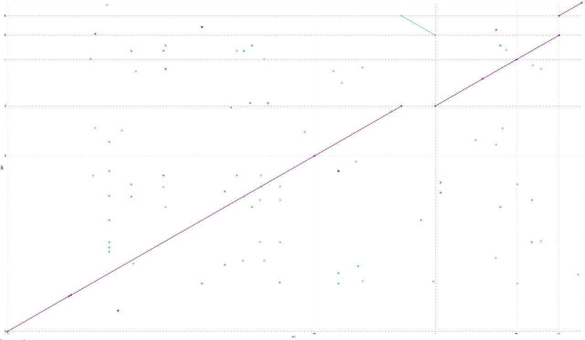

#### Hibrido *trimeado* con largo (1 contig)

``` bash
nucmer --coords unicycler_long unicycler_hybrid_trim
mummerplot out.delta
```

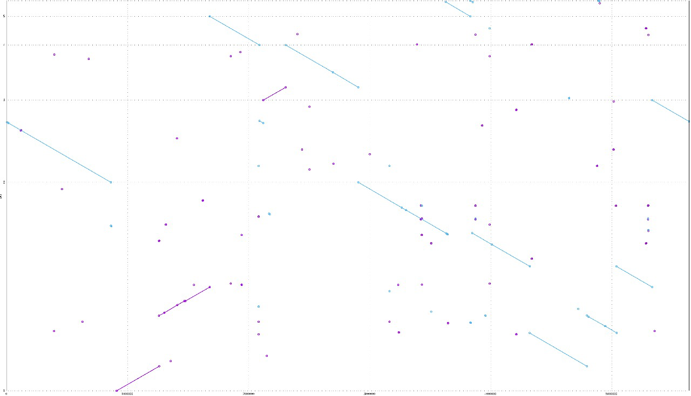

#### Entre híbridos (*trimeado* y crudo)

``` bash
nucmer --coords unicycler_hybrid_crudo unicycler_hybrid_trim
mummerplot out.delta
```

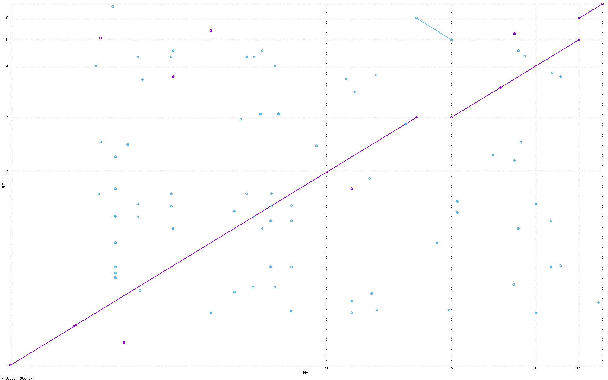

#### Entre longs hechos por FLYE

``` bash
nucmer --coords flye_crudo flye_trim > FLyes
nucmer --coords flye_trim unicycler_long > Flye_trim
nucmer --coords flye_crudo unicycler_long > Flye_crudo
```

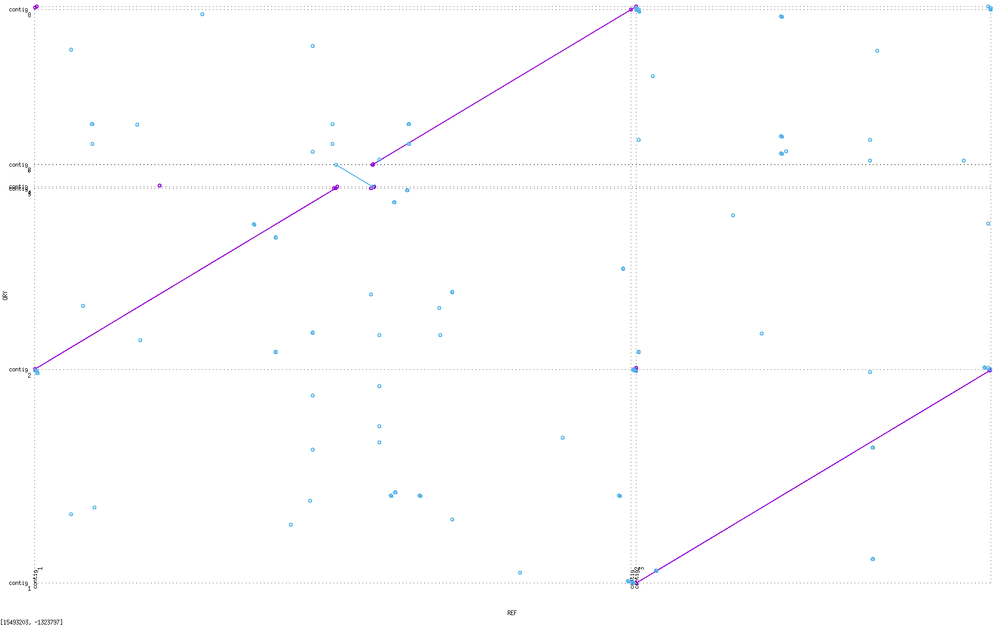

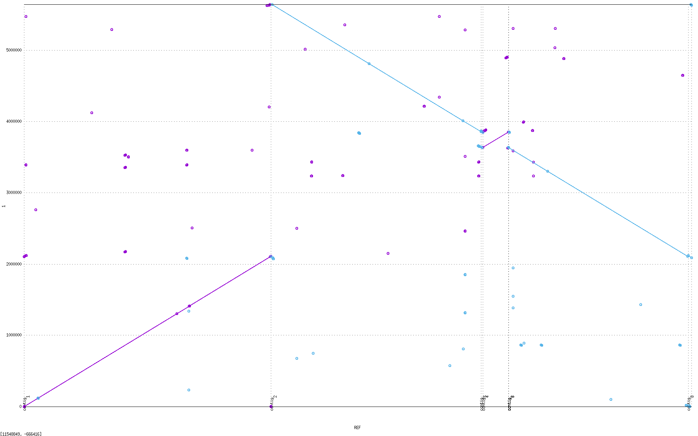

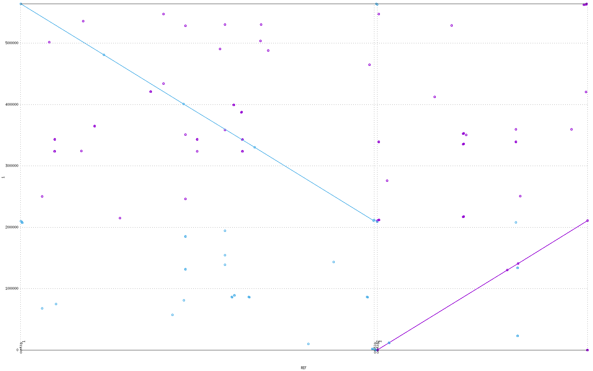

#### Entre canu y unicycler (longs)

``` bash
 nucmer --coords unicycler_long GRP3_canu.contigs.fasta
```

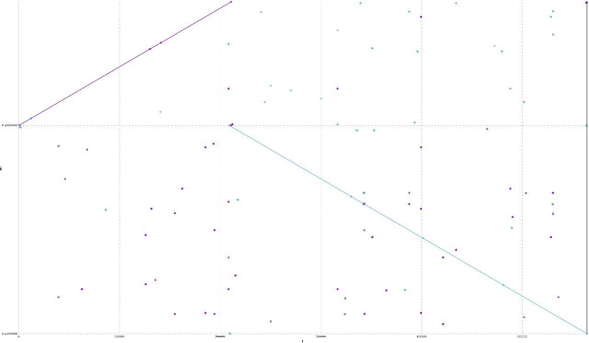

#### Entre los ensambles largos corregidos

``` bash
nucmer --coords assembly_pilon_canu.fasta assembly_pilon_flye.fasta

cd com_uni

nucmer --coords ../assembly_pilon_canu.fasta ../assembly_pilon_uni.fasta
```

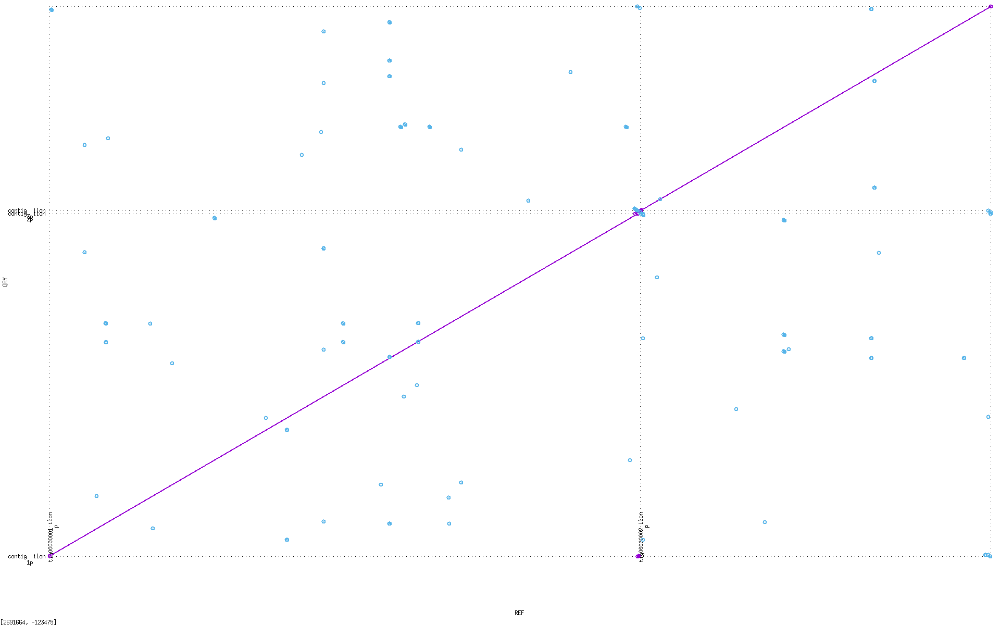

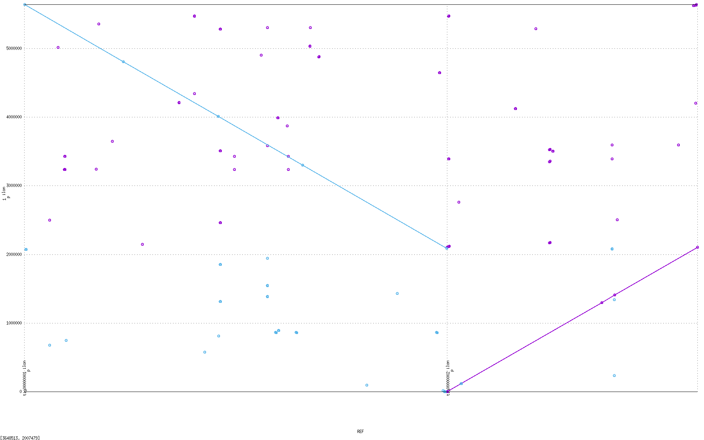

Debido a que el ensamble de `canu` es el que resolvió mejor los contigs y fuimos capaces de mejorarlo a través del software de `pilon`, utilizaremos este ensamble ***canu-pilon*** para los análisis subsecuentes.

## Anotación

Para lograr la anotación y predicción de genes se hizo uso del programa glimmer3 y prokka.

### Glimmer

``` bash
# Creación de folder y link simbólico al ensamble de Canu mejorado por Pilon
mkdir GLIMMER && cd GLIMMER
ln -s \
/export/storage/users/ismadlsh/LCG/S3/GENOMICA/Proyecto/results\
/ensamble/pilon/canu_pilon/PILON_V1/assembly_pilon.fasta
```

Para hacer uso de glimmer3 es necesario ejecutar otros programas.

#### `long-orfs`

Umbral estadístico de longitud de ORFs de 1.5. Tomando en cuenta la longitud del ensamble, consideramos un genoma circular
> Flags:
> `n`: No mostrar información en la pantalla
> `t`: Genes con una puntuación de distancia entrópica inferior a (1.15)

``` bash
# Uso de long-orfs para obtener los marcos de lectura dada un score de entropía
long-orfs -n -t 1.15 assembly_pilon.fasta assembly_pilon_run1.longorfs
```

#### `extract`

``` bash
# Extrae del fasta subsecuencias dadas las coordenadas de .longorfs
extract -t assembly_pilon.fasta assembly_pilon_run1.longorfs > \
assembly_pilon_run1.train
```
> Flags:
> `t`: Omitir el último codón de cada cadena, evitar codones de paro no codificantes 

#### `build-icm`

Patrones de codones y sesgos de composición

``` bash
# Creación del modelo contextual (Selective Markov Model) .icm desde el .train
build-icm -r assembly_pilon.icm < assembly_pilon_run1.train
```
> Flags:
> `r`: Usar las cadenas de manera inversa


#### `glimmer3`

Predicción de genes

``` bash
# Predicción de genes del .fasta con el uso del binario .icm
# Resultado: un set de archivos .glimmer 
glimmer3 -o 50 -g 110 -t 30 assembly_pilon.fasta assembly_pilon.icm \
assembly_pilon_run1.glimmer
```
> Flags:
> `o`: Overlap entre posibles genes
> `g`: Longitud mínima del gene
> `t`: Threshold score para considerar a un gene


#### `extract`

``` bash
# Extrae del fasta subsecuencias dadas las coordenadas de la 
# predicción generando el .ffn
extract -t assembly_pilon.fasta assembly_pilon_run1.glimmer.predict > \
assembly_pilon.ffn
```

Archivos generados: `/home/hectorjl/PROJECT_ENSMBL/results/GLIMMER`

``` bash
lrwxrwxrwx@  119 hectorjl  8 Nov 11:39 assembly_pilon.fasta -> \
/export/storage/users/ismadlsh/LCG/S3/GENOMICA/Proyecto/results/ensamble\
/pilon/canu_pilon/PILON_V1/assembly_pilon.fasta
.rw-r--r--@  35k hectorjl  8 Nov 11:40 assembly_pilon_run1.longorfs
.rw-r--r--@ 1.4M hectorjl  8 Nov 11:41 assembly_pilon_run1.train
.rw-r--r--@ 1.4M hectorjl  8 Nov 11:41 assembly_pilon.icm
.rw-r--r--@ 3.9M hectorjl  8 Nov 11:42 assembly_pilon_run1.glimmer.detail
.rw-r--r--@ 210k hectorjl  8 Nov 11:42 assembly_pilon_run1.glimmer.predict
.rw-r--r--@ 5.2M hectorjl  8 Nov 11:44 assembly_pilon.ffn
```

Con el uso de 'grep', la predicción arrojó 5244 ORF, putativamente apuntando a la misma cantidad de genes.

``` bash
grep -c '^>' assembly_pilon.ffn
5244
```

#### `blastn`

Usamos blastn del fasta resultante (`.ffn`) contra la base de datos *nt* de *NCBI* para la identificación taxonómica del organismo mediante el número de matches `/export/storage/data/blast/db/nt`.

> Incluye *GenBank*, *RefSeq*, *EMBL*...

``` bash
# Links simbólicos al `.ffn` de glimmer y creación del folder para el blasteo
ln -s /home/hectorjl/PROJECT_ENSMBL/results/GLIMMER/* . && \
mkdir BLAST && cd BLAST

# Blast, formato tabular y descriptivos, 1 secuencia por gen
db="/export/storage/data/blast/db/nt"
qsub makeblastn.sh "$db" ../assembly_pilon.ffn 6
qsub makeblastn.sh "$db" ../assembly_pilon.ffn 7

# Versión con headers
echo -e \
"qseqid\tsseqid\tpident\tlength\tmismatch\tgapopen\tqstart\tqend\tsstart\tsend\tevalue\tbitscore" > assembly_pilon.blastn_m6_with_headers.txt && \
cat assembly_pilon.blastn_m6.txt >> \
assembly_pilon.blastn_m6_with_headers.txt
```

El script es el siguiente:

> makeblastn.sh

``` bash
#!/bin/bash
set -euo pipefail

# Argumentos
db=$1
fasta=$2
format=$3

# Extraer el nombre
file=$(basename "$fasta")
name="${file%.*}"

# Blasteo
blastn -db "$db" -query "$fasta" -outfmt "$format" \
-max_target_seqs 1 -out "${name}.blastn_m${format}.txt"
```

> Flags:
> `db`: Base de datos de blast
> `query`: Archivo con las secuencias a buscar
> `outfmt`: Formato de salida (6 es el tabular)
> `max_target_seqs`: Sólo hasta el *n*-ésimo mejor hit por query.
> `out`: Archivo de salida.

**Resultados**

A través del alineamiento, se esclarecieron varias cosas:

1.  En un principio *blast* arrojaba 5727 hits, lo cuál es imposible dado que nuestro `.ffn` contenía 5,244 *ORF*s putativos y utilizamos la opción `max_target_seqs 1`, revelando así que realmente había 3,984 genes únicos.

``` bash
(base) majiso@chaac [BLAST] 🧬 ➜  cut -f1 assembly_pilon.blastn_m6.txt | wc -l              
5727
(base) majiso@chaac [BLAST] 🧬 ➜  cut -f1 \
assembly_pilon.blastn_m6.txt | sort | uniq | wc -l
3984 
```

Esto nos hace pensar que, de los 5,244 *ORF*s predichos por Glimmer3, muchos podrían ser duplicaciones u *ORF*s sobrelapantes.

2.  A pesar de la reducción significativa de ORFs, se pudo determinar aún que el ensamble corresponde al organismo ***Cupriavidus gilardii***, y potencialmente a la cepa *WM02*, con base en los resultados obtenidos.

``` bash
(base) majiso@chaac [BLAST] 🧬 ➜  column -t \
assembly_pilon.blastn_m6_with_headers.txt | head -11
qseqid    sseqid      pident   length  mismatch  gapopen  qstart  qend   sstart   send     evalue     bitscore
orf00002  CP104386.1  99.821   559     0         1        1       558    1881863  1882421  0.0        1026
orf00003  CP104386.1  100.000  177     0         0        1       177    1880621  1880445  3.95e-85   327
orf00004  CP104386.1  100.000  207     0         0        1       207    1880288  1880082  1.01e-101  383
orf00006  CP104386.1  100.000  2448    0         0        1       2448   1879630  1877183  0.0        4521
orf00007  CP104386.1  100.000  414     0         0        1       414    1877124  1876711  0.0        765
orf00008  CP104386.1  100.000  525     0         0        1       525    1876665  1876141  0.0        970
orf00009  CP104386.1  100.000  312     0         0        1       312    1875758  1876069  6.91e-160  577
orf00010  CP104386.1  100.000  915     0         0        1       915    1874621  1875535  0.0        1690
orf00011  CP104386.1  100.000  348     0         0        1       348    1874263  1874610  7.60e-180  643
orf00012  CP104386.1  97.872   1128    0         1        1       1128   1873082  1874185  0.0        1929
(base) majiso@chaac [BLAST] 🧬 ➜  cut -f2 assembly_pilon.blastn_m6_with_headers.txt | sort | uniq -c | sort -nr | head    
   3860 CP104386.1
    860 CP054626.1
    294 CP130340.1
    208 CP104387.1
     70 CP138903.1
     46 CP054624.1
     32 CP120859.1
     31 CP049132.1
     21 CP010554.1
     20 CP141536.1
```

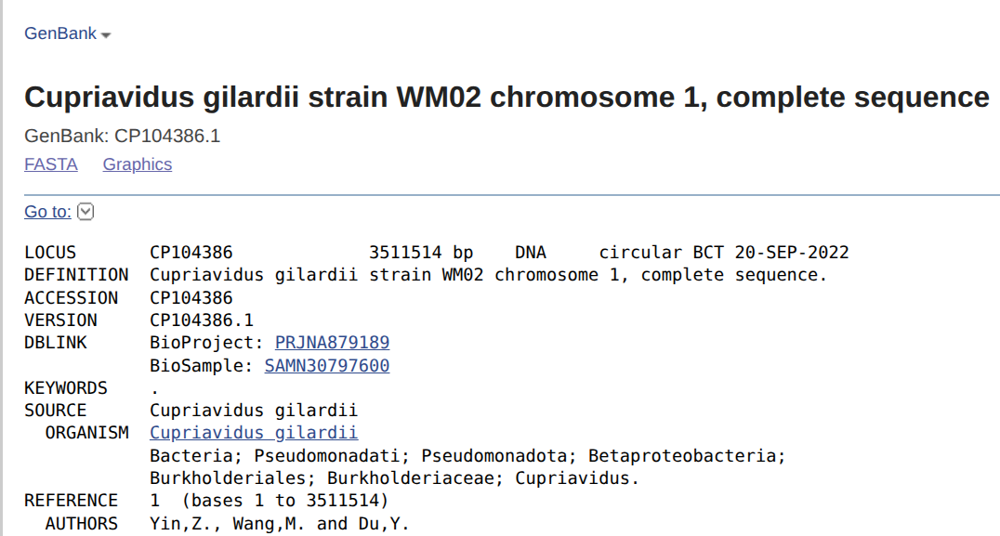 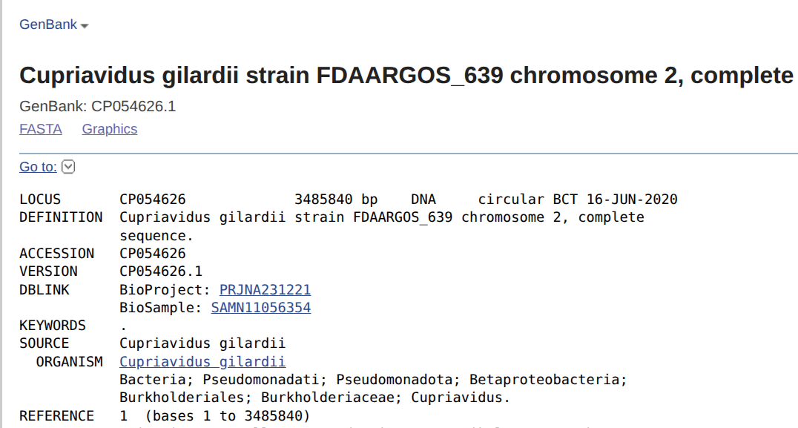

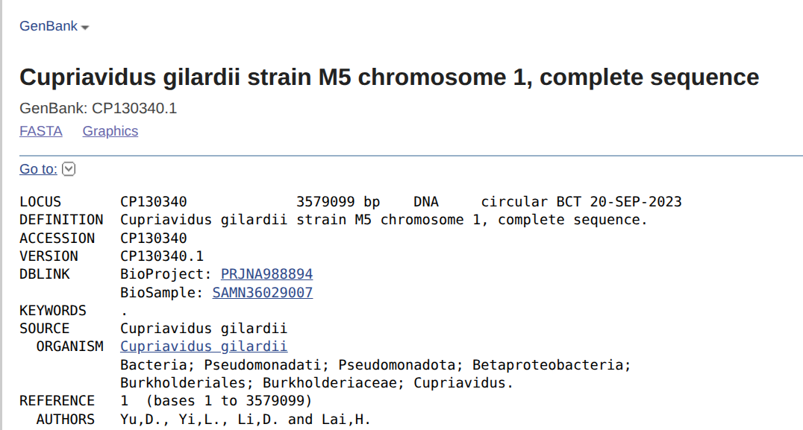

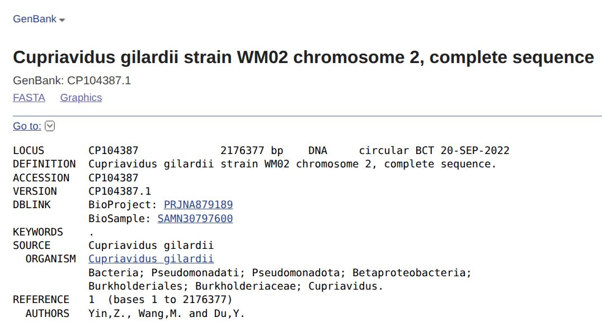

Creemos que la discrepancia entre *hits* con distintas cepas puede deberse al alto intercambio genético por transferencia horizontal en la bacteria. Aún así, los resultados coinciden entre sí con la especie del organismo, que, cabe resaltar, cuenta con dos cromosomas, lo cual coincide con los 2 contigs obtenidos en el ensamble usado, *canu_pilon*.

### `checkm`

Dados los resultados anteriores, nos interesó hacer un control de la calidad y completez del ensamble, por lo que recurrimos a la herramienta *CheckM*, con `lineage_wf`, que le permite hacer su análisis con base en el linaje evolutivo identificado del ensamble.


``` bash
cd ../../
pilon_dir="/export/storage/users/ismadlsh/LCG/S3/GENOMICA/Proyecto/results/ensamble/pilon/canu_pilon/PILON_V1/"
checkm lineage_wf -t 8 -x fasta "$pilon_dir" CHECKM/
```
> Flags:
> `t`: Cores usados
> `x`: Tipo de extensión de los archivos

**Resultados**: Con base en el archivo generado `bin_stats_ext.tsv`:

| Identificación Taxonómica       | Valor                 |
|---------------------------------|-----------------------|
| Linaje de marcadores            | f__Burkholderiaceae   |
| Número de genomas de referencia | 91                    |
| Número total de marcadores      | 596                   |
| Conjuntos de marcadores         | 218                   |

| Calidad                    | Valor  |
|----------------------------|--------|
| Completitud                | 99.89% |
| Contaminación              | 0.23%  |
| Marcadores ausentes (0)    | 2      |
| Marcadores únicos (1)      | 593    |
| Marcadores duplicados (2)  | 1      |
| Marcadores triplicados (3) | 0      |

| Características                | Valor          |
|--------------------------------|----------------|
| Tamaño del genoma              | 5,659,095 bp   |
| Bases ambiguas                 | 0              |
| Scaffolds                      | 2              |
| Contigs                        | 2              |
| Scaffold más largo             | 3,552,973 bp   |
| Contig más largo               | 3,552,973 bp   |
| N50 (scaffolds)                | 3,552,973 bp   |
| N50 (contigs)                  | 3,552,973 bp   |
| Longitud promedio de scaffolds | 2,829,547.5 bp |
| Longitud promedio de contigs   | 2,829,547.5 bp |

| Composición               | Valor  |
|---------------------------|--------|
| Contenido de GC           | 67.57% |
| Desviación estándar de GC | 0.0011 |
| Densidad de codificación  | 0.8855 |
| Tabla de traducción       | 11     |
| Genes predichos           | 5,018  |

### `prokka`

Como un segundo control de verificación del resultado y potencial ventana de mejora en cuanto a predicción de genes, corrimos `prokka` con la información taxonómica del organismo obtenida en *GenBank* (*NCBI*) para evaluar la coincidencia en la anotación.

``` bash
cd ../../ && mkdir -p PROKKA && cd PROKKA

conda activate prokka

# Se utiliza igualmente el ensamble de canu mejorado con pilon
nohup prokka --outdir prokka_cupriavidus --prefix CUP_EQ3 \
--genus Cupriavidus --species gilardii --strain Equipo3 \
--locustag CUP --cpus 10 ../GLIMMER/assembly_pilon.fasta &
```
> Flags:
> `outdir`: Directorio de salida
> `prefix`: Prefijo de los archivos de salida
> `genus`: Género del organismo
> `species`: Especie del organismo
> `strain`: Cepa del organismo
> `locustag`: Prefijo de cada locus tag
> `cpus`: Cores usados


Archivos generados:

``` bash
Permissions Size User   Date Modified    Name
.rw-r--r--@ 5.8M majiso 2025-11-08 17:08 CUP_EQ3.fna
.rw-r--r--@ 5.8M majiso 2025-11-08 17:10 CUP_EQ3.fsa
.rw-r--r--@ 1.9M majiso 2025-11-08 17:10 CUP_EQ3.faa
.rw-r--r--@ 5.3M majiso 2025-11-08 17:10 CUP_EQ3.ffn
.rw-r--r--@ 6.9M majiso 2025-11-08 17:10 CUP_EQ3.gff
.rw-r--r--@ 947k majiso 2025-11-08 17:10 CUP_EQ3.tbl
.rw-r--r--@ 297k majiso 2025-11-08 17:10 CUP_EQ3.tsv
.rw-r--r--@  103 majiso 2025-11-08 17:10 CUP_EQ3.txt
.rw-r--r--@ 1.6M majiso 2025-11-08 17:10 CUP_EQ3.err
.rw-r--r--@  18M majiso 2025-11-08 17:10 CUP_EQ3.sqn
.rw-r--r--@  12M majiso 2025-11-08 17:10 CUP_EQ3.gbk
.rw-r--r--@  65k majiso 2025-11-08 17:10 CUP_EQ3.log
```

**Resultados**

``` bash
(prokka) majiso@chaac [prokka_cupriavidus] 🧬 ➜  cat CUP_EQ3.txt                   
organism: Cupriavidus gilardii Equipo3 
contigs: 2
bases: 5659095
CDS: 5009
rRNA: 12
tRNA: 65
tmRNA: 1
(prokka) majiso@chaac [prokka_cupriavidus] 🧬 ➜  grep -c ">" CUP_EQ3.ffn 
5087
(prokka) majiso@chaac [prokka_cupriavidus] 🧬 ➜  grep -c ">" CUP_EQ3.faa
5009
(prokka) majiso@chaac [prokka_cupriavidus] 🧬 ➜  grep -c \
"hypothetical" CUP_EQ3.faa
2133
```

``` python
100 - 2133 / 5009 * 100 # 57.4166500299461
```

-   **Genes totales**: 5,087
-   **Genes codificantes (CDS)**: 5,009
-   **Tamaño del genoma**: 5.66 Mb
-   **Proteínas anotadas**: 57.42%

`prokka` identificó **5,087 genes**, de los cuales **5,009 son codificantes** de proteínas, 65 de tRNA, 12 de rRNA y 1 de tmRNA contra los **5,214** reportados por *NCBI*, de los cuales **5,063 son codificantes de proteínas**. Estos resultados validan la calidad lograda por el ensamblaje, reflejan un genoma en buen estado y muestran que:

1.  `prokka`, a comparación de `glimmer3` produjo una predicción más conservadora y biológicamente consecuente
2.  La cantidad de proteínas hipotéticas encontradas por `prokka` es normal en bacterias, lo que indica una anotación aceptable
3.  El organismo, después de todo, sí es *Cupriavidus gilardii*

### Comparación de los contigs contra su referencia

#### Obtención de los cromosomas de *Cupriavidus gilardii WM02*

Estos se encuentran, como identificamos en el blasteo, bajo los *ID*s [`CP104386.1`](https://www.ncbi.nlm.nih.gov/nuccore/CP104386.1) y [`CP104387.1`](https://www.ncbi.nlm.nih.gov/nuccore/CP104387.1/) respectivamente, de igual forma en [*GenBank*](https://www.ncbi.nlm.nih.gov/genbank/) ([*NCBI*](https://www.ncbi.nlm.nih.gov)).

Utilizamos un enfoque heurístico para hacer las comparaciones, en el que comparamos el contig más largo con el cromosoma 1 de la cepa *WM02*, pues era el más largo de los dos que tenía. Para el caso del otro contig, lo comparamos tanto con el segundo cromosoma de esa misma cepa, *WM02*. como con el de la *FDAARGOS*, que fue el segundo resultado con más hits obtenido.

``` bash
# Descargar referencias
wget -O WM02_chr1.fasta \
"https://eutils.ncbi.nlm.nih.gov/entrez/eutils/efetch.fcgi?db=nuccore&id=CP104386.1&rettype=fasta&retmode=text"
wget -O WM02_chr2.fasta \
"https://eutils.ncbi.nlm.nih.gov/entrez/eutils/efetch.fcgi?db=nuccore&id=CP104387.1&rettype=fasta&retmode=text"
wget -O FDAARGOS_chr2.fasta \
"https://eutils.ncbi.nlm.nih.gov/entrez/eutils/efetch.fcgi?db=nuccore&id=CP054626.1&rettype=fasta&retmode=text"
```
> Flags:
> `O`: Guarda el archivo descargado bajo el nombre especificado

``` bash
# Comparación
ensamble="/export/storage/users/ismadlsh/LCG/S3/GENOMICA/Proyecto/results/ensamble/pilon/canu_pilon/PILON_V1/assembly_pilon.fasta"

# Contig 1 vs cromosoma WM02 1
nucmer --prefix contig1_WM02chr1 "$ensamble" WM02_chr1.fasta && \
mummerplot contig1_WM02chr1.delta --prefix contig1_WM02chr1

# Contig 2 vs cromosoma WM02 2 
nucmer --prefix contig2_WM02chr2 "$ensamble" WM02_chr2.fasta && \
mummerplot contig2_WM02chr2.delta --prefix contig2_vs_WM02chr2

# 3. Contig 2 vs cromosoma FDAARGOS 2
nucmer --prefix contig2_FDAARGOSchr2 "$ensamble" FDAARGOS_chr2.fasta && \
mummerplot contig2_FDAARGOSchr2.delta --prefix contig2_vs_FDAARGOSchr2
```
> Flags:
> `prefix`: Determina el prefijo de los archivos a generar

**Resultados**: 1. Los dos cromosomas de la cepa *WM02* se alinean precisamente a los dos contigs que nos dio el ensamble, lo que salvo un par de regiones que se encuentran invertidas, refuerza la consistencia del mismo y reafirma que se trata, efectivamente, de esa cepa.

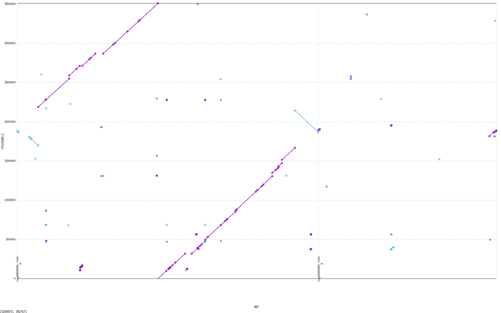

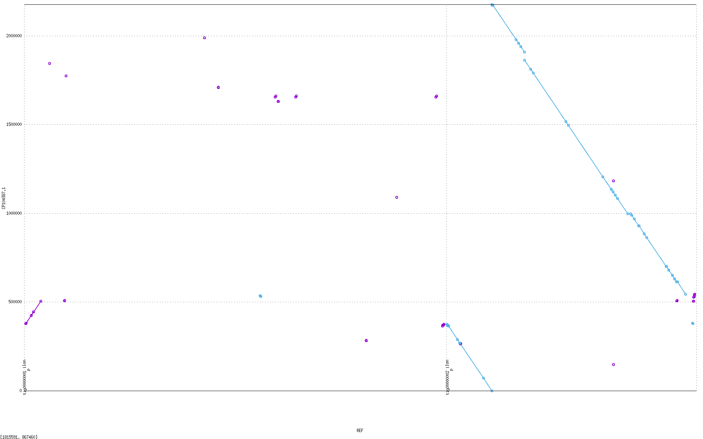

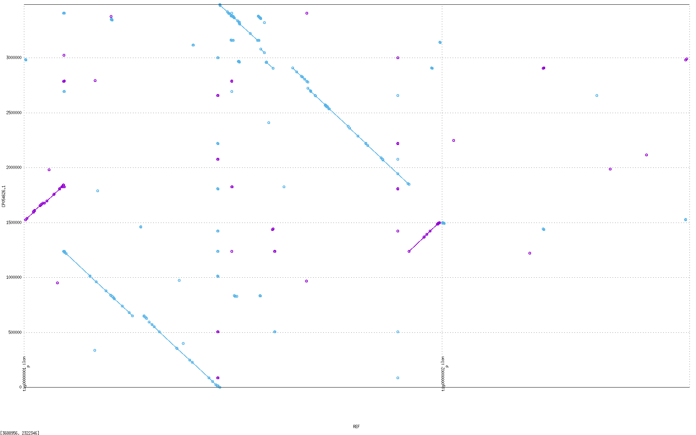

2.  Con respecto a la segunda cepa, *FDAARGOS*, el resultado resulta bastante extraño, pues el segundo cromosoma, correspondiente al *ID* que dio el segundo mayor número de hits en el BLAST contra *nt*, se alinea más bien contra el contig 1 (el más largo) de nuestro ensamble, lo que explica por qué salieron tantos hits con la cepa en el *BLAST*.

Para indagar más sobre ese resultado anómalo, decidimos hacer también el *efetch* del cromosoma 1 de la cepa *FDAARGOS* para hacer el dotplot con mummer contra nuestro ensamble, y ver en qué contigs se alineaba

``` bash
wget -O FDAARGOS_chr1.fasta \
"https://eutils.ncbi.nlm.nih.gov/entrez/eutils/efetch.fcgi?db=nuccore&id=CP054624.1&rettype=fasta&retmode=text"

# 4. Contig vs cromosoma FDAARGOS 1
nucmer --prefix contig2_FDAARGOSchr1 "$ensamble" FDAARGOS_chr1.fasta && \
mummerplot contig2_FDAARGOSchr1.delta --prefix contig2_FDAARGOSchr1
```

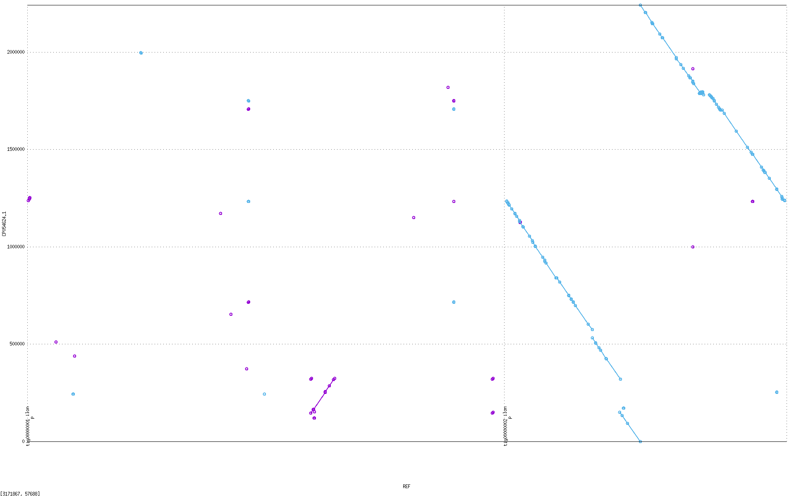

Aunque no podríamos aseverar la razón exacta por la que sucede, al menos observamos consecuencia entre los contigs y los cromosomas con los que se alinea en esta segunda cepa, por más que no dejen de estar cruzados con respecto a la cepa putativa, por la que finalmente nos decantamos: *WM02*.

# Conclusiones

El desarrollo de este proyecto permitió la implementación de un pipeline integral de ensamblaje genómico, combinando estratégicamente las distintas herramientas vistas durante el curso en aras de obtener buenos resultados. La aproximación metodológica, que incluyó el preprocesamiento de lecturas cortas de *Illumina* y el aprovechamiento de lecturas largas de *PacBio*, permitió elegir ensambladores especializados en lecturas largas como *Canu* y *Flye* por sobre otros, como *Velvet* o *Spades*. La obtención de un ensamble final de alta calidad con *Canu* (2 contigs, 99.89% de completitud) y su posterior validación mediante múltiples herramientas bioinformáticas permitió la identificación precisa del organismo como *Cupriavidus gilardii*, con buena posibilidad de pertenecer a la cepa *WM02*. Los análisis comparativos con *Mummer* y la anotación funcional con *PROKKA* nos permitieron confirmar la coherencia estructural y la calidad del genoma reconstruido.

# Referencias

Wikipedia contributors. (2025). «Cupriavidus gilardii». https://en.wikipedia.org/wiki/Cupriavidus_gilardii.
